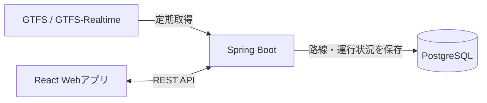

# trafic-radar アジャイル開発設計書

## 1. 文書の目的

本書は、公共交通の運行情報を集約して利用者に提供するWebアプリケーション「trafic-radar」の開発方針、MVPの範囲、機能要件、システム構成を定める。

本書ではチームで共有する判断事項を記載し、画面・API・DBの詳細は実装に必要となった時点でバックログやコードとともに具体化する。開発中に判断を変更した場合は、本書と関連するバックログを更新する。

## 2. プロダクト概要

北海道の公共交通では、運行情報が交通事業者ごとに分散している。trafic-radarは、公開されている運行データを取得・集約し、利用者が路線の運行状況を一つの画面で確認できるようにする。

### 目的

- 利用者が路線の遅延・運休状況をまとめて確認できるようにする。
- データ取得、API、画面表示を一貫して実装し、継続的に改善できる構成にする。

## 3. MVPの範囲

### 対象

- 継続的に利用できることを確認したGTFSおよびGTFS-Realtimeのフィードを1つ取得する。
- GTFSから路線情報を読み込み、GTFS-Realtimeから運行状況を取得する。
- 取得した最新の運行状況を保存し、路線ごとの一覧として表示する。
- 一覧にデータの取得時刻と、状況を判定できない場合の表示を含める。

### 対象外

- ユーザ登録、ログイン、権限管理、お気に入り路線
- メール・チャット等による通知
- 地図表示、管理者画面、運行傾向の分析
- 複数データソースへの対応
- 本番AWS環境の詳細な構築・運用設計

対象外の機能は、MVPの利用結果と優先度をもとにバックログへ追加する。

## 4. 利用者とユーザーストーリー

### 利用者

運行状況を確認したい公共交通の利用者。MVPではアカウント登録なしで一覧を閲覧する。

### ユーザーストーリー

**路線の運行状況を確認する**

> 利用者として、路線ごとの最新の運行状況を一覧で確認したい。移動前に遅延や運休を把握するため。

受け入れ条件:

- 路線名と、その路線について取得できた運行状況を表示する。
- 運行状況にはデータの取得時刻を併記する。
- データが古い、または状況を判定できない場合、通常運行と誤認させず、その状態を表示する。
- 取得に失敗した場合も、最後に正常取得した情報を失わず、画面上で情報の鮮度を確認できる。

## 5. 機能要件

| ID | 要件 | MVPでの完了条件 |
| --- | --- | --- |
| FR-01 | 運行データ取得 | 設定した間隔で対象フィードを取得し、GTFSおよびGTFS-Realtimeを解析できる。 |
| FR-02 | 路線情報管理 | GTFSの路線情報を保存し、運行状況と路線を対応付けられる。 |
| FR-03 | 運行状況保存 | 取得した遅延・運休等の情報と取得時刻を保存できる。判定不能な状態を通常運行として扱わない。 |
| FR-04 | 運行状況API | 路線ごとの最新状況、取得時刻、鮮度を画面向けに返すREST APIを提供する。 |
| FR-05 | 路線一覧表示 | APIから取得した路線ごとの状況を一覧表示し、取得時刻と判定不能・古いデータの状態を利用者に示す。 |
| FR-06 | 取得失敗への対応 | 取得・解析の失敗を記録し、最後に正常取得した情報を保持する。 |

## 6. 非機能要件

- **正確性**: 運行状況はデータ提供元の情報と取得時刻に基づいて表示する。データがないことを正常運行とみなさない。
- **保守性**: データ取得、運行状況の処理、API、画面表示を分け、機能単位で変更・テストできるようにする。
- **テスト容易性**: 外部フィードや外部サービスに接続しない単体テストを作成できる構成にする。
- **情報管理**: MVPでは個人情報を扱わず、公開フィードの取得に必要な情報のみを管理する。

## 7. システム構成

### 技術基準

| 領域 | 採用技術 |
| --- | --- |
| バックエンド | Java 21、Spring Boot 3、Spring Web、Spring Data JPA |
| データ取得 | Spring Scheduler、GTFS-Realtime Protocol Buffersライブラリ |
| データベース | PostgreSQL、Flyway |
| フロントエンド | React、TypeScript、Vite |
| API | REST。API仕様は実装と合わせて管理する。 |
| ローカル開発 | Docker Compose |
| テスト | JUnit 5、Mockito。DB結合テストにはTestcontainersを使用する。 |

### 処理の流れ

1. バックエンドが対象フィードを定期取得する。
2. GTFSの路線情報とGTFS-Realtimeの運行状況を解析し、路線に対応付けて保存する。
3. フロントエンドがREST APIから最新情報を取得し、路線一覧を表示する。
4. 取得に失敗した場合は失敗を記録し、最後に正常取得した情報とその取得時刻を維持する。

## 8. 開発の進め方

機能を小さく分割し、動作する成果を順次追加する。各作業はユーザーストーリーまたは機能要件に紐付け、実装前に受け入れ条件を確認する。

### 開発順

1. 対象フィードの取得と解析
2. 路線情報・運行状況の保存
3. 運行状況API
4. 路線一覧画面
5. 取得失敗・古いデータの表示とテスト

### 完了の基準

- 対応する受け入れ条件を満たしている。
- 変更したロジックに単体テストを追加し、必要な結合テストを実施している。
- 取得失敗時に情報を不正に通常運行として扱わず、既存の正常データを保持する。
- Pull Requestで変更内容と確認結果をレビューできる。

## 9. MVP後のバックログ候補

優先度はMVPの利用結果をもとに決め、着手時に各項目の受け入れ条件を定める。

- ユーザ登録、認証、お気に入り路線
- 登録路線に対する通知
- 対象データソースの追加
- 地図表示
- 管理者向け設定、運行状況の分析
- AWSへのデプロイと運用自動化
